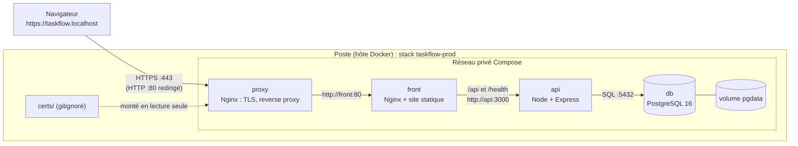
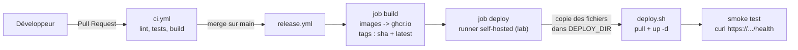

# Architecture de TaskFlow

Ce document répond à la question : *« qu'est-ce qui tourne où, et qui parle à qui ? »*

## Deux stacks Compose séparées sur le même poste

| | Développement | « Production » |
| --- | --- | --- |
| Fichier | `compose.yaml` (dans le dépôt) | `compose.prod.yaml` (copié dans `~/taskflow-prod/`) |
| Nom du projet | dossier du dépôt | `taskflow-prod` |
| Images | construites localement (`build:`) | tirées de ghcr.io (`IMAGE_TAG`) |
| Accès | `http://localhost:8080` | `https://taskflow.localhost` (proxy HTTPS) |
| Configuration | valeurs par défaut | `.env` du dossier de déploiement |

## Vue d'ensemble (production)

Seul le service `proxy` publie des ports (`HTTP_PORT`, `HTTPS_PORT`). Le front, l'API et la
base ne sont **pas** joignables depuis l'extérieur : ils ne sont visibles que sur le réseau
privé créé par Compose.

## Chaîne de livraison (CI/CD)

Le runner `[self-hosted, lab]` est un conteneur sur le poste qui pilote le Docker de la
machine (socket monté) : c'est ce qui lui permet de mettre à jour la stack `taskflow-prod`.
GitHub ne pourrait pas atteindre votre poste depuis Internet.

## Services et ports

| Service | Image | Port conteneur | Publié sur l'hôte | Rôle |
| --- | --- | --- | --- | --- |
| `proxy` | `nginx:1.27-alpine` | 80, 443 | `${HTTP_PORT:-80}`, `${HTTPS_PORT:-443}` | HTTPS, redirection 80 → 443 |
| `front` | `ghcr.io/<owner>/taskflow-front` (Nginx) | 80 | non publié (dev : `8080`) | Sert le site, relaie `/api` et `/health` |
| `api` | `ghcr.io/<owner>/taskflow-api` (Node 20) | 3000 | non publié | API REST |
| `db` | `postgres:16-alpine` | 5432 | non publié | Stockage (volume `pgdata`) |

## Flux d'une requête

1. Le navigateur demande `https://taskflow.localhost/api/tasks`.
2. Le `proxy` termine le TLS (certificat de `certs/`) et transmet à `http://front:80`.
3. Le Nginx de `front` reconnaît le préfixe `/api/` et transmet à `http://api:3000`.
4. L'API lit la base (`db:5432`), répond en JSON, et écrit une ligne de log JSON sur stdout.
5. La réponse remonte le même chemin.

> Le Nginx de `front` re-résout `api` toutes les 10 s (directive `resolver`). Le `proxy`,
> lui, résout `front` au démarrage : `deploy.sh` le recharge (`nginx -s reload`) après chaque
> déploiement. Sans cela, après un redéploiement (nouveau conteneur, donc parfois nouvelle
> adresse IP), ils continueraient d'écrire à l'ancienne adresse : erreur 502.

## Santé et supervision

- `GET /health` → `{ "status": "ok", "db": "up", "version": "<sha>", "env": "production" }`,
  ou **503** si la base est injoignable.
- Chaque conteneur a un `healthcheck` ; `docker compose ps` affiche `healthy` / `unhealthy`.
- `restart: unless-stopped` relance un conteneur tombé.
- Logs de l'API : lignes JSON (`method`, `path`, `status`, `ms`) :
  `docker compose -f compose.prod.yaml logs -f --since 10m api`.

## Configuration

| Variable | Où elle est définie | Rôle |
| --- | --- | --- |
| `DATABASE_URL` | `.env` de `~/taskflow-prod/` | Connexion de l'API à PostgreSQL |
| `POSTGRES_PASSWORD` | `.env` | Mot de passe de la base |
| `APP_ENV` | `.env` | `production` |
| `APP_VERSION` | construite dans l'image par le CI | SHA court affiché dans `/health` |
| `GHCR_OWNER`, `IMAGE_TAG` | `.env` / `deploy.sh` | Quelles images lancer |
| `HTTP_PORT`, `HTTPS_PORT` | `.env` | Ports publiés par le proxy |

Le fichier `.env`, `certs/` et `backups/` n'existent **que** dans le dossier de déploiement.
Ils ne sont jamais versionnés ni copiés par le pipeline.
